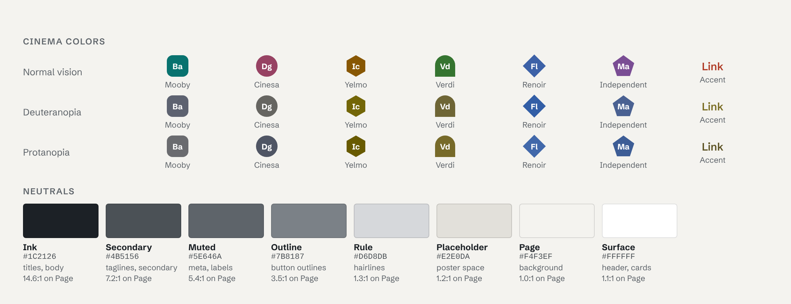

# Barcelona This Week — design brief

Nov 22, 2026 · Jason

## Purpose and guiding principles

Barcelona This Week lists every film showing at Barcelona cinemas, so you can pick a good one and get to a showing with as little effort as possible. It is deliberately opinionated, shaped by one person's taste and habits. There are no accounts, no ads and nothing to set up.

It should feel like a well-edited film section crossed with a film lover's diary: posters first, a confident serif for the films' own words, and a quiet, warm page around them. Letterboxd is the closest reference for tone. It should never look like a ticketing app, a streaming service or a generic dashboard.

Reference mockups may come with this brief. Use them for feel and layout. They predate the brief's later refinements, so wherever the two differ, the brief wins.

Ranked, most important first. When two pull against each other, the higher one wins.

1. **The film leads.** Going to a film takes three answers: which film, when and where. People settle the film first, so everything starts from it, and when and where follow in that order.
2. **Serve both visits.** Some visits start with "what's good?", others with "when is that one on?". Browsing and looking up a known film are both quick.
3. **Glanceable.** What's on, when and where read at a glance, before anything is read closely.
4. **Browse first, filter rarely.** The default view is everything showing, most relevant first. Filters help narrow things down, but nobody needs them to find a good film.
5. **Strong defaults, few options.** The site makes the calls a well-informed friend would, such as what to show and in what order, so visitors rarely have to. Every option has to earn its place.
6. **Correct or absent.** A wrong time fails the site's one job. Anything stale or doubtful is left out rather than shown.
7. **Informative without spoiling.** Show what a poster or the back of the box would tell you. Anything that gives more away is opt-in.
8. **Nothing to set up.** No accounts, no location, no preferences. Anything remembered stays on your device.
9. **Hand off, don't rebuild.** Where another service already does a job well (maps, booking, film databases, find-in-page), link to it. Leaving the site is fine: the goal is getting to a film, not time on the site.
10. **Good on every screen.** Fast, stable and predictable on a phone, an iPad, a laptop or a large monitor.
11. **Web native.** Behaves like a well-made web page and doesn't fight the platform: no scroll-jacking, and scrolling, links, Back and zoom all work as the browser intends.
12. **Honest and neutral.** Ratings are information; no film is promoted because of its score.
13. **Of Barcelona, not a theme.** Local identity shows in small, lasting touches, like the Eixample octagon, never as a costume over the content.
14. **Showtimes just appear.** The site never explains how it knows what's on where, and makes no promises about update frequency; it simply knows. Film details are credited to the service they come from, as its terms require.

## Design principles

These turn the guiding principles into rules for every page. When a design choice is unclear, check it against this list. It's ranked by how directly each rule serves the guiding principles, most important first.

1. **One element, one job, and it does what you'd expect.** Each element looks like what it does, and the same element does the same thing everywhere.
2. **Follow the platform's guidelines.** Where Apple's Human Interface Guidelines or WCAG set a standard (touch targets, contrast, focus, reduced motion), meet it rather than inventing one.
3. **Same content, reflowed.** On a phone the page stacks; it doesn't become a different product.
4. **Calm, not static.** No big, sweeping page animations: content and panels don't slide or fade in and out. Nothing jumps while loading (minimal Cumulative Layout Shift), and nothing scrolls sideways. Small bits of motion are fine — even encouraged — as polish and personality.
5. **Posters bring the color; the interface stays quiet.** Color in the interface is rare and always means something, such as a link or a cinema chain. No gradients, blurs or decorative color.
6. **Hierarchy through type first.** Size, weight and spacing do the work before boxes do. Cards and panels are fine where people expect them, drawn the familiar way. No cards-in-cards, heavy shadows or pill buttons.
7. **Missing data disappears.** What's unknown or empty isn't drawn: no "n/a", blank lines or empty columns. The only exception is where leaving something out would break the layout.
8. **Every cinema has its own icon.** Shape and color for its chain, initials for the venue. After a visit or two, people recognize a cinema at a glance instead of reading its name. The shapes are simple and geometric, like the octagon, and their silhouettes differ enough to tell apart at icon size.
9. **Findable as text.** Content is real text, so find-in-page, copying, translation and screen readers all work.
10. **Icons label; they don't replace words.** A utility icon (rating, runtime, directions) sits beside its word, so nothing needs decoding. An icon may stand alone only when it repeats across a page, is labeled in words somewhere nearby, and a word on every copy would be clutter. It still carries an accessible name.
11. **Personality from type and voice.** Typography carries the identity. The wording is plain American English, with occasional dry humor in quiet places ("Popcorn not included"). Strings of facts read as phrases or sit on their own lines, never joined by dot or bullet separators.
12. **One signature shape.** The cut-corner octagon of an Eixample block is used the same way everywhere. Filled means on; outlined means off.
13. **All caps only for small section labels.** Everything else is normal case.

## Pages

What each page holds. Anything not written here follows the principles above.

**Every page**

- Header: the logo, linking home, and two links, Films and Cinemas, with the current one marked. The logo is an Accent octagon with a small white play triangle inside, followed by "Barcelona This Week" in bold Ink.
- Footer: links to About and Privacy, when listings were last updated ("Updated today, 05:00"), and one quiet line of humor ("Popcorn not included").
- Every film and every cinema has its own address that keeps working, so any page can be bookmarked or shared.

**Home**

- A lead line saying how many films are showing, never framed as "this week". Then the filters as one sentence: "Showing films in English, on any date, in all genres, most relevant first, including films I've seen." Each underlined choice is a native picker.
- Sections in order: Now showing, Last chance, Starting soon. All three use the same grid and cards; an empty section isn't drawn.
- Each card: the poster with the seen toggle in its corner; a short note (Last chance and Starting soon only); the title as text, with the year unless it's this year; rating and runtime; genres; tagline; director; IMDb and Letterboxd links. Cards keep full details on phones; a long scroll is fine. Seen films fade.
- Filters apply to all three sections, and a section that filtering leaves empty isn't drawn. The lead line counts the films shown after filtering ("12 films showing in English").
- Filter choices survive Back, a reload and a shared link.

**Film page**

- Poster, title, director, rating, runtime, genres, tagline, full synopsis and cast, with Trailer, IMDb and Letterboxd links and a full-width "Seen it?" button.
- Showtimes: one row per day, with Afternoon, Evening and Late columns (see Data rules); only columns with showings are drawn. Each showing is one line: cinema icon, time (the booking link) and short cinema name. A cinema's name or icon opens its place page in a maps service, with no external arrow, since every showing has one.
- "Showing at" cinema filter: all on by default; tap one to see only it; "Show all" resets. Grouped by chain, then alphabetical.

**Cinemas page**

- A lead line saying how many cinemas are showing films, one static map of all cinemas with the cinema icons as pins, and a list of cinema names that jump to their entries.
- Cinemas grouped by chain. Each entry: icon, name, neighborhood, a one-line description, Directions and Website buttons, and the posters of what it's showing.

**About**

- What the site is, how to use it (pick a film, pick a time, tap the time to book), where film details come from, and who made it: one person, a side project, no ads or accounts. No contact link.
- Carries the credit the film-data source requires, and no other page does. For TMDb, that's its notice and an approved logo, less prominent than the site's own.
- Never explains how showtimes are collected.

**Privacy**

- A plain opening statement: no accounts, cookies, analytics or tracking.
- What's kept on the device (films marked seen), how it can be lost (clearing site data; Safari drops it after seven days without a visit), and a button to forget it.
- What other services see: posters load from the film-data source, and booking, website and maps links leave the site.

**Don't build**

| Idea | Why not |
| --- | --- |
| Dark mode | Not wanted. |
| Visual themes (newspaper, ticket stub, menu and the like) | A theme competes with the content ("Of Barcelona, not a theme"). |
| Maps on film pages | One map, on the Cinemas page; on a film page the times matter more. |
| Location, distance or travel time | Needs setup ("Nothing to set up"); Directions hands off to a maps service. |
| Highlighting films by score or showing count | "Honest and neutral". |
| Animated panels, accordions, horizontal scroll | "Calm, not static" and "Web native". |
| A search box | Find-in-page covers it. Revisit only if search can do more (accent-insensitive, typo-tolerant). |
| A cinema preview card | A maps service does it better ("Hand off, don't rebuild"). |
| Address and metro in cinema details | Directions covers it. |
| IMDb and Letterboxd logos | Colorful noise beside posters; text links are clearer. |
| A contact link | Not wanted. |

## Visual system

Use these values and nothing else; every contrast figure is against WCAG 2.2 AA.

**Color**

| Token | Value | On Page | Use |
| --- | --- | --- | --- |
| Ink | #1C2126 | 14.6:1 | Titles, body, filled octagon, focus ring |
| Secondary | #4B5156 | 7.2:1 | Taglines and other secondary text |
| Muted | #5E646A | 5.4:1 | Meta, labels, credits |
| Outline | #7B8187 | 3.5:1 | Button outlines, filter ticks |
| Rule | #D6D8DB | decorative | Hairlines |
| Placeholder | #E2E0DA | decorative | Reserved and missing poster space |
| Page | #F4F3EF | — | Background |
| Surface | #FFFFFF | — | Header, footer, cards and panels |
| Accent | #B03C27 | 5.4:1 | Links and the logo |

Two families: warm paper (Page, Placeholder, Surface) under one cool slate ink (OKLCH hue 248°, chroma 0.012), so every gray reads as part of one set. Accent is only 2.7:1 against Ink, too close to mark a link by color alone, so links inside running text are underlined.

**Cinema chain colors**

| Chain | Color | White letters |
| --- | --- | --- |
| Mooby | #08726F | 5.8:1 |
| Cinesa | #974263 | 6.4:1 |
| Yelmo | #885703 | 6.2:1 |
| Verdi | #357430 | 5.7:1 |
| Renoir | #3C61A7 | 6.1:1 |
| Independent | #7A4D94 | 6.3:1 |

All six share one OKLCH lightness (0.50) and chroma (0.12), with hues spread around the wheel and away from the accent, so no chain looks louder than another and none reads as a link. With color blindness some chains converge; shape and letters carry identity, so color is never the only cue (WCAG 1.4.1). A new chain gets a new hue at the same lightness and chroma, clear of the accent and the existing hues, plus a new silhouette.

**Type**

One type scale: base 16px, each step 1.2× the last. Every size on the site is a step on this scale, so sizes relate to each other instead of being picked one by one. On a phone, the three largest roles drop one step; everything else stays the same.

| Step | Size | Roles |
| --- | --- | --- |
| −1 | 13px | Meta, credits, section labels (caps, slightly tracked) |
| 0 | 16px | Interface text, links, buttons, showtimes (tabular figures), card taglines |
| 1 | 19px | Card titles, synopsis and About text, film page tagline, filter sentence |
| 2 | 23px | Logo |
| 3 | 28px | Lead line (home, About) |
| 5 | 40px | Page titles (film, About, Privacy) |

Newsreader sets the film's own words: titles, taglines (italic), synopses. Schibsted Grotesk sets everything the site says itself. Long text gets generous line spacing (about 1.6).

Fonts are served by the site itself, with no third-party requests. Text appears immediately in a size-matched fallback, so the font swap causes no layout shift. Font files cover only what English, Spanish and Catalan need, including ñ, ç and the Catalan l·l.

**Layout and spacing**

- One centered content column with a maximum width, set by the content: wide enough for five posters at a comfortable size, narrow enough that synopses keep a readable line length (about 60–75 characters). On a large monitor the margins grow; the posters don't.
- Home grid: as many columns as fit with posters at least about 180px wide, up to five. That's 2 on a phone, 4 on an iPad in portrait, and 5 from iPad landscape up. Rows sit further apart than columns, so each poster and its details read as one unit.
- Film page: a narrow poster column beside the main column only when the main column still gets about 600px (enough for a readable synopsis and three showtime columns). Otherwise it stacks, as on a phone.
- Posters: 2:3, slightly rounded, hairline edge, no shadow, space reserved before load.
- Tap targets: meet Apple's HIG minimum (44pt).

**Shapes and icons**

- Octagon: a square with 45° corners cut back about 1/8 of the side, like an Eixample block (cut a little deeper at small sizes so the corners still read); buttons carry a smaller version of the same chamfer. Used for the logo, the seen toggle, filter ticks and button outlines.
- Seen states: off = translucent smoky fill, white edge and tick; on = Ink fill, white tick.
- Line icons (always with a word): star (rating), clock (runtime), pin (directions), play (trailer), external arrow (leaves the site), tick.
- Cinema icons: Mooby rounded square, Cinesa circle, Yelmo hexagon, Verdi arch, Renoir diamond, Independent pentagon; two-letter code inside.

**Controls**

- Links: Accent, normal case, underlined on hover. Underlined in running text and for times; standalone links (IMDb, Directions) are not.
- Buttons: chamfered outline (Outline color), Ink text; hover darkens the outline. Filled Ink only for an "on" state.
- Home filters are native pickers; the visible part is the underlined word. The film page's cinema filter is a row of toggles with octagon ticks.
- Motion: the seen toggle's springy press-and-pop sets the tone: quick, small, a slight overshoot, only in direct response to a tap. Off when reduced motion is set.
- Focus: a clearly visible Ink outline on every interactive element; never removed.

## Data rules

Tuning values, like the rating weight, are set against real listings.

| Rule | Behavior |
| --- | --- |
| What's listed | Everything every cinema has published, from now through its latest listed date: a rolling window, not a fixed week. Listings are refreshed often enough that new days appear soon after a cinema publishes them. |
| Published through | For each cinema, the last date it has published listings for. Drives the partial-day note and Last chance. |
| Partly published days | A day that some cinemas haven't published yet gets a quiet note on that day ("More showings to come"), never a page-wide warning. |
| Language filter | English-language films in their original version (default), or all showings. Every showing is marked as original version or dubbed. Filters showings, then hides films with none left, like the date filter. The film page follows the same choice and says when it's hiding showings, with a link to show them. |
| Genre filter | All genres (default), or one genre from the film data. Hides films outside it. |
| Now showing | Every listed film not in Last chance or Starting soon. |
| Sort: most relevant (default) | A blend of the film-data source's rating (a weighted average: films with few votes are pulled toward the typical score, so new releases still get a fair rating) and its popularity, so a well-rated film nobody's heard of doesn't outrank a big release by default. Weighting to tune against real listings. Ties broken by showing count. |
| Sort: most popular | The film-data source's popularity score. |
| Last chance | The film's final showing is today or tomorrow, and every cinema showing it has published listings at least two days past that. Otherwise the end of the listing window would make every film look like it's ending. Card note: the showing when only one is left ("Today 15:15 at Phenomena"), otherwise the count, plus the cinema if there's only one ("3 showings, all at Maldà"). |
| Starting soon | First listed showing is after today. Card note: "From Fri 20". |
| Date filter | Any date (default), today, tomorrow, then each listed day. Filters showings, then hides films with none left. |
| Time of day | Afternoon before 17:00; Evening 17:00–20:59; Late 21:00 and after. The breaks follow Barcelona's day: free after work from about 17:00, dinner around 21:00. |
| Today's past showings | Hidden once the start time has passed. |
| Booking link | Direct booking URL when the listing has one; otherwise the cinema's site, marked with an external arrow. |
| Seen | A list of stable film IDs, stored on the device. Affects fade and the optional "hiding films I've seen" filter. |

**Cinema data:** what the site needs to know about each cinema.

| Field | Example | Used for |
| --- | --- | --- |
| Name | Mooby Balmes | Cinemas page |
| Short name | Balmes | Showtime lines |
| Chain | Mooby | Icon shape and color, grouping |
| Code | Ba | Icon letters |
| Neighborhood | Sant Gervasi | Cinemas page |
| Description | Multiplex | Cinemas page |
| Location | Its position on the map | Pins on the Cinemas page map |
| Maps place | Its entry in the maps service | Cinema name link, Directions |
| Website | The cinema's own site | Website button, fallback booking link |

## States and edge cases

Every state below is written as a rule; the build is checked against each one.

| Case | Rule |
| --- | --- |
| No poster | A Placeholder-colored 2:3 block with the title in the serif, the same size as a poster, so the grid holds. |
| Long titles | Wrap, never truncate, so find-in-page and screen readers get the whole title. Cards align at the top; uneven heights are fine. |
| Many cinemas for one film | Showtimes run as long as they need to: no collapsing, no sideways scroll. The "Showing at" filter is how people narrow it. |
| Nothing matches the filters | One plain sentence saying so, plus the single change that fixes it ("Nothing in English on Tuesday. Show any date?"). Never a blank page. |
| Late at night | When today has nothing left, offer tomorrow rather than an empty page. |
| Stale data | If an update fails, days that may be out of date are hidden rather than shown ("Correct or absent"). |
| Everything marked seen | A short line saying so, with a way to show seen films. Never an empty grid. |
| No JavaScript | Listings, booking links and pages all work. Only the filters and the seen toggle need JavaScript. |
| Page not found | One plain sentence, a light touch of humor, and a link home. |

## Checking the build

- The home page, loaded with a full set of real listings, meets every rule in this brief: grid, missing data, long titles, Last chance and Starting soon.
- Each case in States and edge cases behaves as written.
- Layout holds from a phone to a large monitor, per the Layout rules.
- Every page is usable within about two seconds on a mid-range phone over 4G.
- Every page meets WCAG 2.2 AA.
- Filter choices survive Back, a reload and a shared link; every film and cinema address opens the right page.
